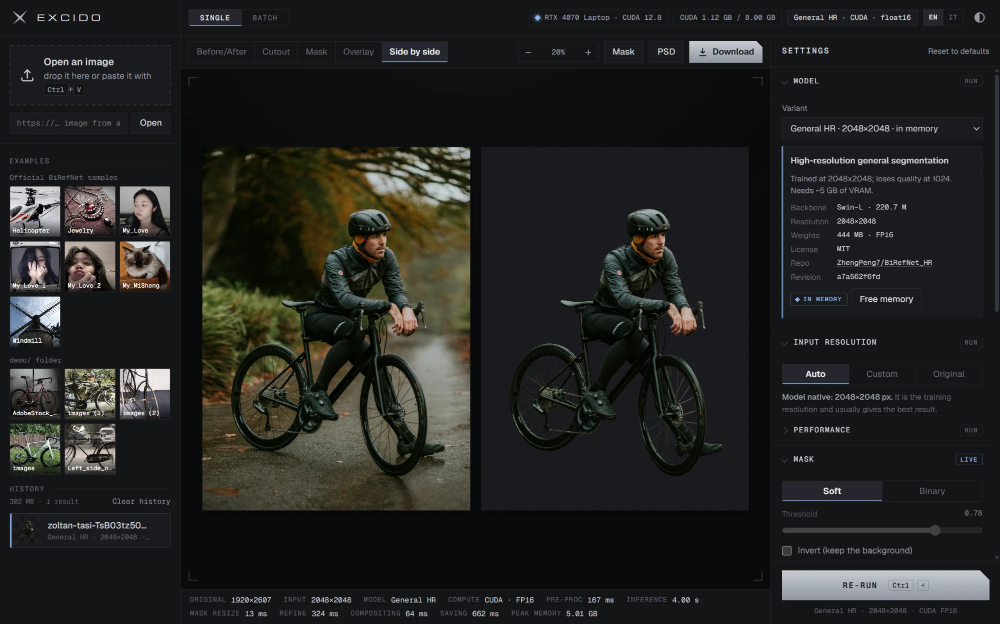

<p align="center"></p>
<p align="center"><b>English</b> · <a href="README.it.md">Italiano</a></p>
<p align="center"><a href="https://github.com/NewMediaDesign/excido/actions/workflows/ci.yml"></a> </p>

Excido is a local background-removal studio built on [BiRefNet](https://github.com/ZhengPeng7/BiRefNet), the state of the art in high-resolution dichotomous image segmentation (Zheng Peng et al., CAAI AIR 2024). The model runs on your own GPU or CPU and the interface opens in your browser. Your images never leave your computer.

<p align="center"></p>

- **Web app.** It has a before/after slider, a cutout on a checkerboard, mask and overlay views, zoom and pan, history, batch processing with ZIP export, and an English/Italian interface.
- **Every runtime setting.** You control resolution, precision, device, threshold, grow/shrink of the selection in half-pixel steps, feather, edge clean-up (`refine_foreground`), background and export format ([docs/PARAMETERS.md](docs/PARAMETERS.md)).
- **Mask brush.** You can fix the selection by hand: add or erase with an adjustable size and hardness, with undo and redo. Strokes reach every export, the PSD included.
- **16 official BiRefNet variants.** General, HR, Lite, Dynamic, Matting, Portrait and the paper models are all available. Seven are downloaded at setup, the rest with one click ([docs/MODELS.md](docs/MODELS.md)).
- **MCP server.** Claude and other MCP clients can remove backgrounds for you, inside a folder you choose ([docs/MCP.md](docs/MCP.md)).
- **Layered PSD export.** The subject comes with an editable layer mask, plus the hidden original and the background.
- **Command line.** `excido remove` processes files or folders with the same settings as the web app.
- **Cross-platform.** It runs on NVIDIA (CUDA) on Windows and Linux, on Apple Silicon (Metal) on macOS, or on the CPU anywhere.

## Requirements

| | Windows 10/11 | Linux | macOS |
|---|---|---|---|
| Accelerator | NVIDIA, driver 570+ (CUDA 12.8) | NVIDIA, driver 570+ (CUDA 12.8) | Apple Silicon (M1 or later), Metal |
| Without a GPU | CPU (slow) | CPU (slow) | Intel Macs are not supported (no recent PyTorch builds) |
| Disk | ~10 GB (PyTorch plus the 7 core models) | same | ~5 GB |

You also need [uv](https://docs.astral.sh/uv/), which installs Python 3.12 and the dependencies into a project-local `.venv`, and an internet connection for setup only.

## Quick start

**1. Install uv** (once).

Windows (PowerShell):

```bash
powershell -ExecutionPolicy ByPass -c "irm https://astral.sh/uv/install.ps1 | iex"
```

macOS and Linux:

```bash
curl -LsSf https://astral.sh/uv/install.sh | sh
```

**2. Get the code and install Excido.** This downloads about 3 GB of PyTorch and 3.7 GB of models, so it takes 10–30 minutes.

```bash
git clone https://github.com/NewMediaDesign/excido.git
```

```bash
cd excido
```

```bash
uv sync
```

```bash
uv run excido setup
```

`excido setup --models all` downloads all 16 models (about 10 GB). `--models none` skips them; you can then download them from the app. On Windows you can run `.\setup.ps1` instead, and `bash setup.sh` on macOS and Linux.

**3. Start it.** The app opens <http://127.0.0.1:7860> in your browser.

```bash
uv run excido
```

Useful options:
- `--offline` never contacts Hugging Face.
- `--port 8000` changes the port.
- `--no-browser` doesn't open a browser window.

The wrappers `.\run.ps1` and `bash run.sh` start the app the same way.

## Using the app

1. **Open an image.** Click an example, drop a file anywhere, paste one with <kbd>Ctrl</kbd>/<kbd>⌘</kbd>+<kbd>V</kbd> or enter a URL.
2. The model processes it, and the result appears with the **before/after slider**.
3. **Adjust the settings on the right.**
   - The **live** sections (Mask, Brush, Edge colors, Background, Export) update instantly.
   - The **run** sections (Model, Resolution, Performance) need a new run: the button changes to *Re-run to apply*.
4. **Touch up** where the model missed. In the **Brush** panel, choose **Add** or **Erase** and paint on the image.
5. **Download** the cutout (PNG/WebP with transparency, or a composite), the mask, or a **layered PSD** with an editable layer mask.
6. **Batch.** In the Batch tab you can process many images at once and download a ZIP.

Results stay in the **history** on the left. The × on a row deletes that result, and **Clear history** deletes them all after an inline confirmation. The space they take in `outputs/` is shown above the list.

| Key | Action |
|---|---|
| <kbd>1</kbd>–<kbd>5</kbd> | Before/After, Cutout, Mask, Overlay, Side by side |
| <kbd>Space</kbd> (hold) | Show the original (pans while painting) |
| <kbd>F</kbd> / <kbd>0</kbd> | Fit / 100% |
| wheel, drag, double-click | Zoom, pan, fit |
| <kbd>B</kbd> / <kbd>E</kbd> / <kbd>Esc</kbd> | Brush: add / erase / off |
| <kbd>[</kbd> / <kbd>]</kbd> | Smaller / larger brush |
| <kbd>Ctrl</kbd>/<kbd>⌘</kbd>+<kbd>Z</kbd>, <kbd>Ctrl</kbd>/<kbd>⌘</kbd>+<kbd>Shift</kbd>+<kbd>Z</kbd> | Undo / redo a stroke |
| <kbd>Ctrl</kbd>/<kbd>⌘</kbd>+<kbd>Enter</kbd> | Run (or start the batch) |

## Command line

```bash
uv run excido remove photos/ --out results/ --model general-hr
```

```bash
uv run excido remove photo.jpg --background "#ffffff" --format webp
```

```bash
uv run excido remove portrait.jpg --grow 1.5 --feather 2 --psd
```

```bash
uv run excido download --list
```

`excido --help` and `excido <command> --help` list every option. The `excido smoke` command runs an end-to-end check of the downloaded models, measuring time and memory.

## MCP server (Claude and other agents)

While the app is running, it exposes an MCP endpoint at `http://127.0.0.1:7860/mcp`. The tools only read images from one **workspace folder**, `~/Pictures/Excido` by default, and only write results into its `excido-output/` subfolder. Image URLs and model downloads stay off unless you enable them.

To connect it to Claude Code:

```bash
claude mcp add --transport http excido http://127.0.0.1:7860/mcp
```

Claude Desktop, and any other client that starts local commands, uses `excido mcp`. Add this to `claude_desktop_config.json`:

```json
{
  "mcpServers": {
    "excido": {
      "command": "uv",
      "args": ["run", "--directory", "/path/to/excido", "excido", "mcp"]
    }
  }
}
```

Tools, options and security notes are in [docs/MCP.md](docs/MCP.md).

## Measured performance

These numbers come from an RTX 4070 Laptop (8 GB) with PyTorch 2.11 and CUDA 12.8, on a 3577×2163 image, after warm-up.

| Model | Input | Precision | Inference | Peak memory | Full request\* |
|---|---|---|---|---|---|
| General | 1024² | FP16 | 0.40 s | 1.6 GB | 1.4 s |
| General | 1024² | BF16 | 0.56 s | 3.0 GB | 1.6 s |
| General | 1024² | FP32 | 0.72 s | 3.1 GB | 1.9 s |
| General Lite | 1024² | FP16 | 0.15 s | 0.8 GB | 1.1 s |
| Matting / Portrait | 1024² | FP16 | 0.41 s | 1.6 GB | 1.4 s |
| General Dynamic | 2048×1216 | FP16 | 0.87 s | 3.1 GB | 1.9 s |
| General HR / Matting HR | 2048² | FP16 | 1.5 s | 5.0 GB | 2.6 s |
| General HR | 2304² (FP16) or 2048² (FP32) | | | over the limit | clean out-of-memory error in 3–4 s |
| General Lite on CPU | 1024² | FP32 | 6–12 s | — | |

\* The full request covers decoding, inference, `refine_foreground`, compositing and writing the PNGs.

## Project layout

```
excido/            Python package: engine, post-processing, web server, MCP server, CLI
excido/static/     web interface (HTML, CSS, JS; fonts bundled, works offline)
tests/             pytest suite (no GPU or downloads needed)
docs/              architecture, parameters, models, MCP (English); docs/it/ Italian
pyproject.toml     dependencies; uv.lock pins them for Windows, Linux and macOS
models/            downloaded weights            (created at runtime, not in git)
examples/          official sample images        (created at runtime, not in git)
outputs/           results and history           (created at runtime, not in git)
demo/              your own test images, shown as a second gallery (optional, not in git)
```

## Configuration

| Variable | Effect |
|---|---|
| `EXCIDO_HOME` | Data folder for models, examples and outputs. The default is the project folder (or `~/.excido` when installed as a package). |
| `EXCIDO_MODELS_DIR` | Where models are stored (default `<EXCIDO_HOME>/models`), e.g. on a bigger disk. |
| `EXCIDO_GALLERY` | Folder shown as the second gallery (default `demo/`). |
| `EXCIDO_VRAM_FRACTION` | Hard cap on GPU memory, between 0 and 1 (see [docs/ARCHITECTURE.md](docs/ARCHITECTURE.md)). |
| `EXCIDO_MCP_ROOT` | MCP workspace folder (default `~/Pictures/Excido`). |
| `EXCIDO_MCP` | Set to `0` to disable the `/mcp` endpoint. |
| `HF_TOKEN` | Optional Hugging Face token for faster downloads. |

## Troubleshooting

| Problem | Fix |
|---|---|
| The device chip says "CPU only" on an NVIDIA PC | Run `nvidia-smi` and update the driver to 570 or later, then run `uv sync` again. |
| "Out of GPU memory" | Lower the resolution, use FP16, try a Lite model, or enable the CPU fallback. |
| A run takes minutes instead of seconds | Another program is using the GPU memory. On Windows the NVIDIA driver then spills into system RAM and everything slows to a crawl. Close the other program and restart Excido. |
| "The model isn't downloaded yet" | Use the **Download** button in the Model panel, or run `uv run excido download <id>`. |
| Port 7860 is busy | `uv run excido serve --port 8000` |

## Development

```bash
uv run pytest
```

```bash
uv run ruff check
```

```bash
uv run ruff format
```

CI runs lint, the test suite and a real CPU inference with the Lite model on Windows, Linux and macOS. See [CONTRIBUTING.md](CONTRIBUTING.md) and the [code of conduct](CODE_OF_CONDUCT.md). Report security problems privately as described in [SECURITY.md](SECURITY.md).

## License and credits

Excido is released under the [MIT](LICENSE) license. It is an independent project, not affiliated with the BiRefNet authors, Hugging Face or Adobe.

- **BiRefNet.** Code and weights are by Peng Zheng et al., MIT. The weights are downloaded from [huggingface.co/ZhengPeng7](https://huggingface.co/ZhengPeng7) and are not redistributed here.
- **Third parties.** The `refine_foreground` attribution, the bundled fonts (Michroma, Geist, Geist Mono, all SIL OFL) and the notes on datasets and sample images are in [THIRD_PARTY_NOTICES.md](THIRD_PARTY_NOTICES.md).
