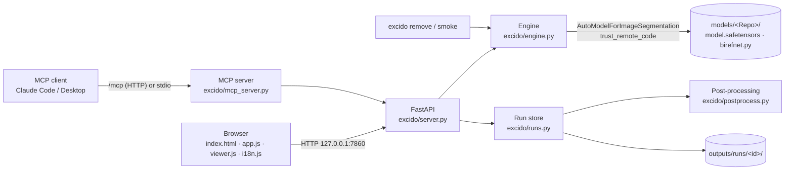

# Architecture

English · [Italiano](it/ARCHITETTURA.md)

Excido is a small local server. Python runs the model on your GPU (or CPU), and the browser is the interface. MCP clients talk to the same process. The network is used only to download libraries and models.

## Stack

| Layer | Technology | Why |
|---|---|---|
| Environment | `uv` + `pyproject.toml` + `uv.lock`, Python 3.12, `.venv` in the project | One command on every OS, isolated from the rest of the system, reproducible. |
| Compute | PyTorch: 2.11 + CUDA 12.8 on Windows and Linux (works with driver 570+); 2.14 from PyPI on macOS (Metal) | uv picks the right build per platform, as declared in `[tool.uv.sources]`. |
| Model | `transformers` AutoModel + remote `birefnet.py`, `timm`, `kornia`, `einops` | The official loading path from the model card. |
| Server | FastAPI + uvicorn | One Python process, with interactive API docs at `/api/docs`. |
| MCP | official `mcp` SDK (`MCPServer`), Streamable HTTP mounted on the app, plus stdio | Shares the engine with the web UI. |
| UI | HTML, CSS and JavaScript (ES modules), no build, no CDN; fonts bundled | Works offline; edit with any text editor. |

## Components

| File | Responsibility |
|---|---|
| `excido/__init__.py` | Data folders (`EXCIDO_HOME`). Points `HF_HOME` inside them and enables the MPS fallback. |
| `excido/catalog.py` | The 16 variants: repo, pinned revision, backbone, native resolution, size, license. |
| `excido/store.py` | Downloads into `models/<Repo>/` at the pinned revision, and verifies it. |
| `excido/engine.py` | Device selection (CUDA, MPS or CPU), model loading (one at a time), pre-processing, inference, mask resize, timings and memory, OOM handling. |
| `excido/postprocess.py` | Threshold and invert, `refine_foreground`, compositing, overlay, PNG/WebP encoding. |
| `excido/runs.py` | Each result is a *run*: original and raw mask on disk, an in-memory LRU cache, rendering. |
| `excido/server.py` | REST API, background jobs (downloads, batch), static files, host check, MCP mount. |
| `excido/mcp_server.py` | MCP tools, the workspace sandbox, and two backends: in-process, or forwarding to a running app. |
| `excido/cli.py` | The `excido` command: `serve`, `setup`, `download`, `examples`, `remove`, `mcp`, `smoke`. |
| `excido/static/` | The UI. `app.js` holds state, settings, API calls and batch; `viewer.js` zoom, pan and the five view modes; `i18n.js` EN/IT. |

## How a run works

1. **Input.** The browser sends `POST /api/segment` with a file, a URL or an example reference, plus `params` (inference) and `post` (post-processing).
2. **Decoding.** `open_image` decodes the image and applies its EXIF orientation.
3. **Inference.** `Engine.predict` does the following:
   - resolves the device (`auto` means CUDA, then MPS, then CPU);
   - loads the model if needed, then warms it up;
   - computes the input size, in multiples of 32;
   - preprocesses: `Resize`, `ToTensor`, `Normalize(ImageNet)`;
   - runs `model(x)[-1].sigmoid()`;
   - resizes the mask back to the original size.
4. **Storage.** `RunStore.create` stores the original and `mask_raw.npy` (float16) in `outputs/runs/<id>/`.
5. **Rendering.** `render` writes `mask.png`, the cutout or composite, `overlay.jpg`, `thumb.png` and `meta.json`.
6. **Live changes.** A change to a *live* setting calls `POST /api/runs/{id}/postprocess`, which repeats only step 5.

## API

Interactive docs are at <http://127.0.0.1:7860/api/docs>.

| Method | Path | Description |
|---|---|---|
| GET | `/api/system` | Devices, memory, versions, loaded model. |
| GET | `/api/models` | Catalog with status (downloaded, in memory, downloading). |
| POST | `/api/models/{id}/download` | Starts a download job. |
| POST | `/api/models/unload` | Frees GPU memory. |
| GET | `/api/examples` | Official samples and the gallery folder. |
| POST | `/api/segment` | Takes multipart `file`, `url` or `source`, plus `params` and `post` (JSON). Returns the run. |
| POST | `/api/runs/{id}/postprocess` | Re-renders with new `post` settings. |
| GET | `/api/runs/{id}/psd?lang=en` | Layered PSD (subject + layer mask, hidden original, background), built by `excido/psd_export.py` with psd-tools. |
| GET | `/api/runs` | Recent runs, for the history. |
| POST | `/api/backgrounds` | Uploads a background image and returns `bg_image_id`. |
| POST | `/api/batch` · GET `/api/jobs/{id}` | Batch job and its progress; the ZIP goes in `outputs/batch/<job>/`. |
| POST/GET | `/mcp` | MCP Streamable HTTP endpoint (see [MCP.md](MCP.md)). |

Errors carry a `code`, `params` and `hints` (codes). The UI translates them, and `error` holds the English text.

## Design decisions

- **Pinned remote code.** `trust_remote_code` runs the Hugging Face repo's `birefnet.py`. It is downloaded at a fixed commit and stays readable in `models/<Repo>/`.
- **One process owns the GPU.** The web UI, the MCP endpoint and the stdio MCP server (when the app is running) all go through the same Engine. A lock serializes inference and post-processing. Two processes fighting over 8 GB is exactly what makes Windows spill into system RAM.
- **Hard VRAM cap.** On Windows, when VRAM runs out, the NVIDIA driver silently moves memory into system RAM ("Sysmem Fallback"). One inference went from about 3 s to 15 minutes. To prevent that, the Engine sets `torch.cuda.set_per_process_memory_fraction` just below the free memory, so PyTorch raises a clean `OutOfMemoryError` instead, which is reported or retried on the CPU. `empty_cache()` after each run hands activation caches back to the driver. `EXCIDO_VRAM_FRACTION` overrides the cap.
- **Raw mask kept.** The model runs once; threshold, refine and background are re-rendered in a few hundred milliseconds.
- **`refine_foreground` rewritten with cumulative sums.** The original uses an `avg_pool2d` with a 90×90 kernel (O(r²) per pixel) or OpenCV. A separable box filter built on `cumsum` is O(1) per pixel, runs on CUDA, MPS and CPU, and needs no OpenCV. It accumulates in float64, or float32 on MPS, which has no float64.
- **Compositing with PIL's `Image.composite`.** It is about five times faster than float numpy on 8 MP photos. Lossless WebP uses the minimum effort: `method=4` took about 8 s on 8 MP, `method=0` about 0.2 s.
- **Resize without keeping proportions**, like the official code: it is how the model was trained and evaluated.
- **Security.**
  - The server listens on 127.0.0.1.
  - `TrustedHostMiddleware` blocks DNS rebinding.
  - The MCP endpoint additionally validates `Origin`.
  - MCP tools are sandboxed to a single folder.
  - Uploads and URL downloads are capped at 100 MB.
- **UI files are always revalidated.** `/` and `/static/` are served with `Cache-Control: no-cache`, so after an update the browser never shows a stale interface. Unchanged files still come back as cheap 304 responses.

## Known limits

- There is no authentication: the app is meant for one local user.
- Jobs live in memory; runs on disk survive a restart.
- `outputs/` is never cleaned automatically (about 10–20 MB per 8 MP run).
- Not supported: video, manual mask editing, ONNX/TensorRT, `torch.compile`. See [PARAMETERS.md](PARAMETERS.md).
- Apple Silicon support is implemented, but it is only exercised by CI on the CPU, not on a real Metal GPU.
