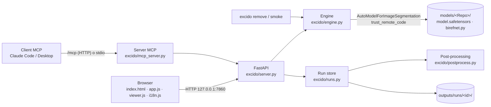

# Architettura

[English](../ARCHITECTURE.md) · Italiano

Excido è un piccolo server locale. Python fa girare il modello sulla tua GPU (o CPU), e il browser fa da interfaccia. I client MCP parlano con lo stesso processo. La rete serve solo per scaricare librerie e modelli.

## Stack

| Livello | Tecnologia | Perché |
|---|---|---|
| Ambiente | `uv` + `pyproject.toml` + `uv.lock`, Python 3.12, `.venv` nel progetto | Un solo comando su ogni sistema, isolato e riproducibile. |
| Calcolo | PyTorch: 2.11 + CUDA 12.8 su Windows e Linux (driver 570+); 2.14 da PyPI su macOS (Metal) | uv sceglie la build giusta per piattaforma, come dichiarato in `[tool.uv.sources]`. |
| Modello | `transformers` AutoModel + `birefnet.py` remoto, `timm`, `kornia`, `einops` | È il metodo di caricamento ufficiale del model card. |
| Server | FastAPI + uvicorn | Un solo processo Python, con documentazione API su `/api/docs`. |
| MCP | SDK ufficiale `mcp` (`MCPServer`), Streamable HTTP montato sull'app, più stdio | Condivide il motore con l'interfaccia web. |
| Interfaccia | HTML, CSS e JavaScript (ES modules), senza build e senza CDN; font inclusi | Funziona offline e si modifica con un editor di testo. |

## Componenti

| File | Responsabilità |
|---|---|
| `excido/__init__.py` | Cartelle dei dati (`EXCIDO_HOME`). Imposta `HF_HOME` al loro interno e abilita il ripiego MPS. |
| `excido/catalog.py` | Le 16 varianti: repo, revisione bloccata, backbone, risoluzione nativa, dimensione, licenza. |
| `excido/store.py` | Download in `models/<Repo>/` alla revisione bloccata, e relativa verifica. |
| `excido/engine.py` | Scelta del dispositivo (CUDA, MPS o CPU), caricamento del modello (uno alla volta), pre-processing, inferenza, ridimensionamento della maschera, tempi e memoria, gestione dell'OOM. |
| `excido/postprocess.py` | Soglia e inversione, `refine_foreground`, composizione, overlay, codifica PNG/WebP. |
| `excido/runs.py` | Ogni risultato è un *run*: originale e maschera grezza su disco, cache LRU in memoria, rendering. |
| `excido/server.py` | API REST, job in background (download, batch), file statici, controllo dell'host, montaggio MCP. |
| `excido/mcp_server.py` | Strumenti MCP, cartella di lavoro protetta, e due backend: nello stesso processo, oppure inoltro all'app già aperta. |
| `excido/cli.py` | Il comando `excido`: `serve`, `setup`, `download`, `examples`, `remove`, `mcp`, `smoke`. |
| `excido/static/` | L'interfaccia. `app.js` gestisce stato, parametri, chiamate API e batch; `viewer.js` zoom, pan e le cinque modalità di vista; `i18n.js` EN/IT. |

## Flusso di un'elaborazione

1. **Input.** Il browser invia `POST /api/segment` con un file, un URL o il riferimento a un esempio, più `params` (inferenza) e `post` (post-processing).
2. **Decodifica.** `open_image` decodifica l'immagine e applica l'orientamento EXIF.
3. **Inferenza.** `Engine.predict` esegue questi passi:
   - sceglie il dispositivo (`auto` significa CUDA, poi MPS, poi CPU);
   - carica il modello se serve, poi fa il warm-up;
   - calcola la risoluzione di input, in multipli di 32;
   - pre-processa: `Resize`, `ToTensor`, `Normalize(ImageNet)`;
   - esegue `model(x)[-1].sigmoid()`;
   - riporta la maschera alla dimensione originale.
4. **Salvataggio.** `RunStore.create` salva l'originale e `mask_raw.npy` (float16) in `outputs/runs/<id>/`.
5. **Rendering.** `render` scrive `mask.png`, il ritaglio o composito, `overlay.jpg`, `thumb.png` e `meta.json`.
6. **Modifiche live.** Una modifica a un parametro *live* chiama `POST /api/runs/{id}/postprocess`, che ripete solo il passo 5.

## API

La documentazione interattiva è su <http://127.0.0.1:7860/api/docs>.

| Metodo | Percorso | Descrizione |
|---|---|---|
| GET | `/api/system` | Dispositivi, memoria, versioni, modello caricato. |
| GET | `/api/models` | Catalogo con lo stato di ogni modello (scaricato, in memoria, in download). |
| POST | `/api/models/{id}/download` | Avvia un job di download. |
| POST | `/api/models/unload` | Libera la memoria GPU. |
| GET | `/api/examples` | Esempi ufficiali e cartella galleria. |
| POST | `/api/segment` | Riceve in multipart `file`, `url` o `source`, più `params` e `post` (JSON). Restituisce il run. |
| POST | `/api/runs/{id}/postprocess` | Rifà il rendering con nuovi parametri `post`. |
| GET | `/api/runs/{id}/psd?lang=it` | PSD a livelli (soggetto + maschera di livello, originale nascosto, sfondo), generato da `excido/psd_export.py` con psd-tools. |
| GET | `/api/runs` | Elaborazioni recenti, per la cronologia. |
| POST | `/api/backgrounds` | Carica un'immagine di sfondo e restituisce `bg_image_id`. |
| POST | `/api/batch` · GET `/api/jobs/{id}` | Job batch e relativo avanzamento; lo ZIP finisce in `outputs/batch/<job>/`. |
| POST/GET | `/mcp` | Endpoint MCP Streamable HTTP (vedi [MCP.md](MCP.md)). |

Gli errori hanno un `code`, dei `params` e degli `hints` (codici). L'interfaccia li traduce, e `error` contiene il testo inglese.

## Scelte progettuali

- **Codice remoto bloccato.** `trust_remote_code` esegue il `birefnet.py` del repo Hugging Face. Viene scaricato a un commit fisso e resta leggibile in `models/<Repo>/`.
- **Un solo processo usa la GPU.** Interfaccia web, endpoint MCP e server MCP stdio (quando l'app è aperta) passano tutti dallo stesso Engine. Un lock serializza inferenza e post-processing. Due processi che si contendono 8 GB sono esattamente ciò che fa spostare la memoria nella RAM su Windows.
- **Limite rigido alla VRAM.** Su Windows, quando la VRAM finisce, il driver NVIDIA sposta la memoria nella RAM di sistema senza dare errore ("Sysmem Fallback"). Abbiamo misurato un'inferenza passata da circa 3 s a 15 minuti. Per evitarlo, l'Engine imposta `torch.cuda.set_per_process_memory_fraction` appena sotto la memoria libera: PyTorch solleva subito un `OutOfMemoryError`, che viene segnalato o ritentato su CPU. Dopo ogni elaborazione `empty_cache()` restituisce al driver la cache delle attivazioni. `EXCIDO_VRAM_FRACTION` cambia il limite.
- **Maschera grezza conservata.** Il modello gira una volta sola; soglia, refine e sfondo si ricalcolano in qualche centinaio di millisecondi.
- **`refine_foreground` riscritto con somme cumulative.** L'originale usa un `avg_pool2d` con kernel 90×90 (O(r²) per pixel) oppure OpenCV. Un box filter separabile basato su `cumsum` costa O(1) per pixel, gira su CUDA, MPS e CPU e non richiede OpenCV. Accumula in float64, o in float32 su MPS, che non supporta float64.
- **Composizione con `Image.composite` di PIL.** È circa 5 volte più veloce di numpy in float sulle foto da 8 MP. Il WebP lossless usa lo sforzo minimo: `method=4` impiegava circa 8 s su 8 MP, `method=0` circa 0,2 s.
- **Resize senza mantenere le proporzioni**, come nel codice ufficiale: è il modo in cui il modello è stato addestrato e valutato.
- **Sicurezza.**
  - Il server ascolta su 127.0.0.1.
  - `TrustedHostMiddleware` blocca il DNS rebinding.
  - L'endpoint MCP valida anche l'header `Origin`.
  - Gli strumenti MCP sono limitati a una sola cartella.
  - Upload e download da URL hanno un limite di 100 MB.
- **I file dell'interfaccia vengono sempre ricontrollati.** `/` e `/static/` sono serviti con `Cache-Control: no-cache`, così dopo un aggiornamento il browser non mostra mai un'interfaccia vecchia. I file non cambiati tornano comunque come risposte 304, leggere.

## Limiti noti

- Non c'è autenticazione: l'app è pensata per un solo utente locale.
- I job vivono in memoria; i run su disco sopravvivono al riavvio.
- `outputs/` non viene mai ripulita automaticamente (circa 10–20 MB per un run da 8 MP).
- Non sono supportati video, ritocco manuale della maschera, ONNX/TensorRT e `torch.compile`. Vedi [PARAMETRI.md](PARAMETRI.md).
- Il supporto Apple Silicon è implementato, ma la CI lo verifica solo su CPU, non su una vera GPU Metal.
